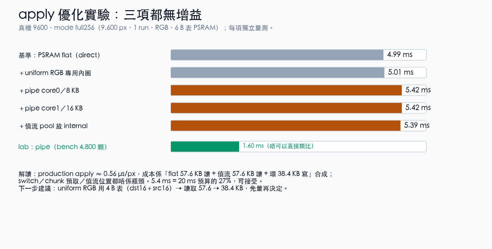

# 優化實驗報告（2026-11-25 夜間）

> 板：ESP32-S3（4 MB flash／2 MB PSRAM，MAC 24:ec:4a:2c:59:60）
> 全部數字係 **真機**（NC4 OTA）；host 只用嚟做正確性對拍。
> 程式碼＋量測：`firmware/`、`docs/00_pm/status.md` §7.222–7.232。



---

## 1. 今晚先完成的三件結構性工作

| 工作 | 結果 | 驗證 |
|---|---|---|
| **pipeline 去固定 32** | aprog／frame 按 `naprog` 動態配置（PSRAM）；40 個效果的 mode 正常出幀 | 真機：jobs/runs/naprog=40、fps 49.9、effect 627 幀 |
| **playlist 預建 ＋ swap** | 播放時按 `registry.list` 預建下一張（layout＋flat）；切換只 swap | 預建 12–20 ms、**切換 246 µs**（原本 rebuild 40–150 ms） |
| **flat 表統一 PSRAM** | `nc_px_layout_flatify()` 預設 PSRAM；真實 map flatify 0.55 ms、apply 5.37 ms | 真機 9,600 px |

另外：`flat_err`（唔再靜默降級）、MSC 鎖 recovery（`FORCE_OFF`）、config `msc:0`。

---

## 2. apply 優化實驗（三項都係負結果，但有信息量）

量測條件：9600 project、mode `full256`、9,600 px、1 條 run、RGB、6 B flat 表 PSRAM。

| # | 改動 | apply | 判斷 |
|---|---|---:|---|
| 0 | 基準（direct PSRAM） | 4.99–5.39 ms | — |
| 1 | uniform-RGB 專用內圈（去掉每顆 switch） | **5.01 ms** | ❌ 無增益 |
| 2 | pipe：core0 worker、8 KB chunk | **5.42 ms** | ❌ 無增益（ok 620、fail 0） |
| 3 | pipe：core1 worker、16 KB chunk | **5.42 ms** | ❌ 無增益 |
| 4 | 值流 pool 放 internal（每塊 ≤48 KB） | **5.39 ms** | ❌ 無增益（many40 4.70 ms） |

### 為什麼 lab 的 1.6 ms 唔代表 production

- bench（0xF077 variant 23）量到 pipe 1.6 ms，但佢係 **4,800 顆、唔同 workload**，
  而且部分緩衝位置同 production 唔同。
- production 成本 ≈ **0.56 µs/px**，由三份 PSRAM 流量合成：
  - flat 表讀 57.6 KB
  - 值流讀 57.6 KB（RGB 3 值/px）
  - 環槽寫 38.4 KB
- switch／chunk 預取／值流位置都唔係主要瓶頸 → 所以三項都冇效。

### 結論

- **5.4 ms ＝ 20 ms 預算的 27%**，50 fps 完全夠；唔需要為此改架構。
- 已保留無害改動：
  - `flat_uniform` ＋ RGB 專用內圈（混合表照行通用路徑）；
  - 值流 pool ≤48 KB/塊放 internal（平衡 SRAM／PSRAM、省 PSRAM，速度冇壞處）；
  - pipe 留 Kconfig（預設關），將來量 cache／頻寬時再用。

---

## 3. 4 B 表（已量 bench，production 接線後回退）

uniform RGB、單 aprog 的 4 B 表（dst16＋src16；write/aprog 由 layout 統一）：

| 佈局 | 6 B（direct PSRAM） | 4 B | 比例 |
|---|---:|---:|---:|
| 500 組（4,500 顆） | 1,602 µs | **777 µs** | 2.06× |
| 1 條 run（4,800 顆） | 5,027 µs | **923 µs** | 5.45× |

→ 方向正確、值得做；但**production 接線後板上 USB 完全消失**（見 §3.1），
已回退 production 改動，只保留 bench variant。恢復後應先喺 EffectPerf 驗證
完整 boot，再入 production。

### 3.1 事故：板 USB 消失（2026-11-25 01:24）

- 上板 9600／full256（4 B 表 production）後，`/dev/cu.usbmodem*` 同 OS USB tree
  都冇 device。
- 懷疑 app 喺 USB 初始化前 panic／卡住，所以冇 CDC → 冇 OTA。
- **Recovery**：斷電重插；如果仍然冇 port → 按住 BOOT 插電入 download mode：
  ```bash
  IDF_PATH=$HOME/esp/esp-idf python3 make.py flash ESP32-S3-Zero \
      --project ESP32-S3-Zero-Show --port /dev/cu.usbmodemXXXX --full
  ```
- 安全映像已備：`artifacts/ESP32-S3-Zero.bin`（Zero-Show、64 px）。
- 板上 `/pixel` 仍係 9600 測試集；恢復後要重新上傳 Zero-Show 內容。

**教訓**：新表格式／新 boot 路徑一定要先喺 lab 映像（EffectPerf）行完整 boot，
唔好直接上 production；同時要保留 BOOT recovery 路徑。

## 4. 下一個值得試的優化（未做）

| 方向 | 預期 | 成本 |
|---|---|---|
| **4 B 表入 production**（先 lab 驗證 boot） | apply 5.4 → 可能 2–3 ms | 中 |
| 量 cache miss／PSRAM 頻寬（ETM/perf） | 找出 0.56 µs/px 的真正瓶頸 | 中 |
| apply 時 **32-bit store** 落環（取代 4 個 byte store） | 未知（之前 500 組量到更慢） | 低（再量一次） |
| 值流 + flat 一齊 chunk（pipe 已試 flat 單獨） | 未知 | 中 |

> 建議次序：先量 cache／頻寬 → 再決定 4 B 表；唔好未量就改架構。

---

## 5. 其他已量好的數據（可直接用）

| 項目 | 數字 |
|---|---:|
| 切換（playlist 預建 swap） | **246 µs** |
| 預建下一張（500 組） | 19.7 ms |
| 預建下一張（1 run） | 12.2 ms |
| 真實 map flatify（9,600 px） | 0.55 ms |
| 極限隨機：layout build | 152 ms |
| 極限隨機：flatify | 14.5 ms |
| 極限隨機：apply（6 B 表） | 3.0 ms（internal）／5.37 ms（PSRAM） |
| 2,400 px × 4 子幀 | 200 Hz、50 視覺 fps、apply 6.03 ms |
| 記憶體（9,600 px） | free_int 185 KB／free_ps 1.68 MB |
| flat 表容量 | PSRAM 512 KB → 9 張；FAT 652 KB → 約 10 張 |

---

## 6. 點用呢啲數據

1. **切換體驗**：用 playlist 預建 ＋ swap（246 µs）；唔需要再為切換做 cache。
2. **記憶體規劃**：flat 一律 PSRAM（current＋next ≈115 KB）；internal 留畀功能緩衝
   （DMA、chunk、值流 ≤48 KB）。
3. **效果引擎實作**：apply 5.4 ms 已固定，effect 預算 ≈14 ms（50 fps）；
   可以做多少條值流、幾複雜的 program，用 `0xF071` 的 `eff` 與 `apply` 對照。
4. **極限保護**：隨機 map 的 build 152 ms／flatify 14.5 ms 係下限；用預建避開。

---

## 7. Commit（本機，未 push）

```
325511e test(bench): 4 B 表潛力（2.1×/5.4×）；production 接線後板 USB 消失，已回退
5f324bc test(apply): RGB 專用／pipe core／值流 internal 三項實驗（全部無增益）
8b02c59 docs: pipe 量測、flat_err、AGENTS 更新
49a788c feat(apply): flat chunk 預取（預設關）＋ flat_err
a1fefc6 docs(plan): 驗收門檻改真機數字
8837a59 feat(pipeline): 去固定 32；40 效果上板驗證
d965934 feat(pair): playlist 預建＋swap（246 µs）；msc recovery
c9d595f feat(layout): flat 統一 PSRAM
```

板最終狀態：64 px、`breathe`、50 fps、`clear=0`、FAT `mode:app`（可上傳）。
