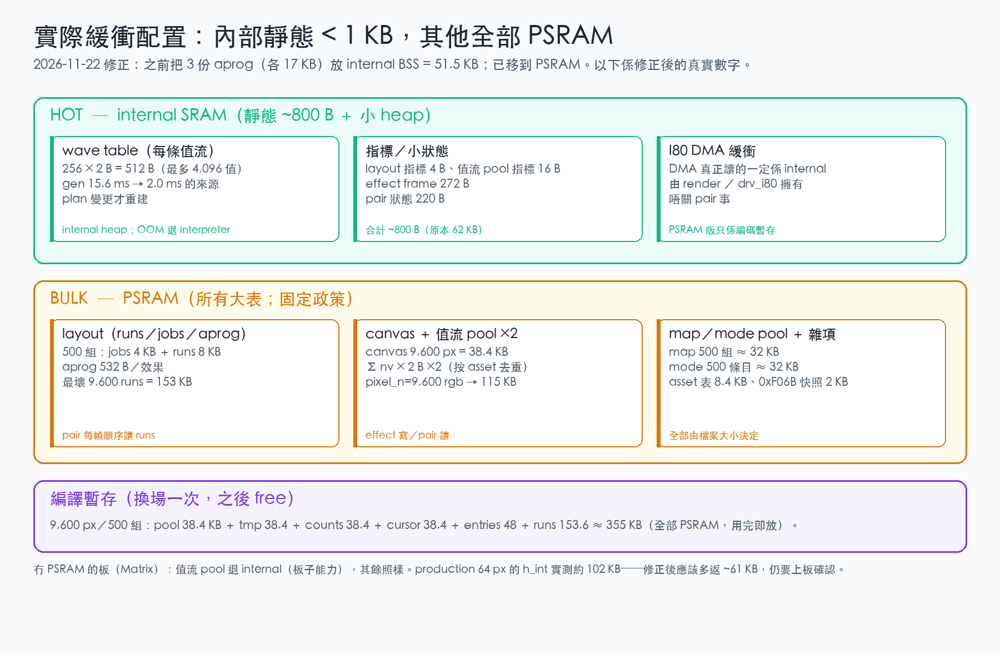
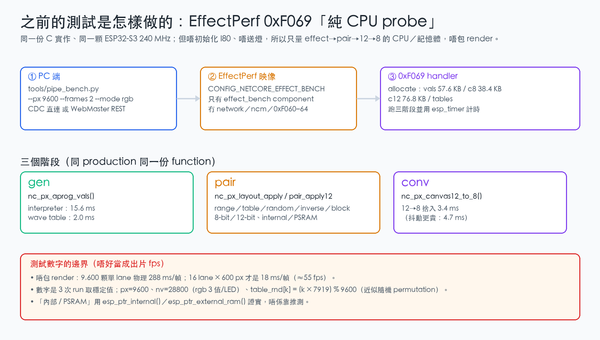
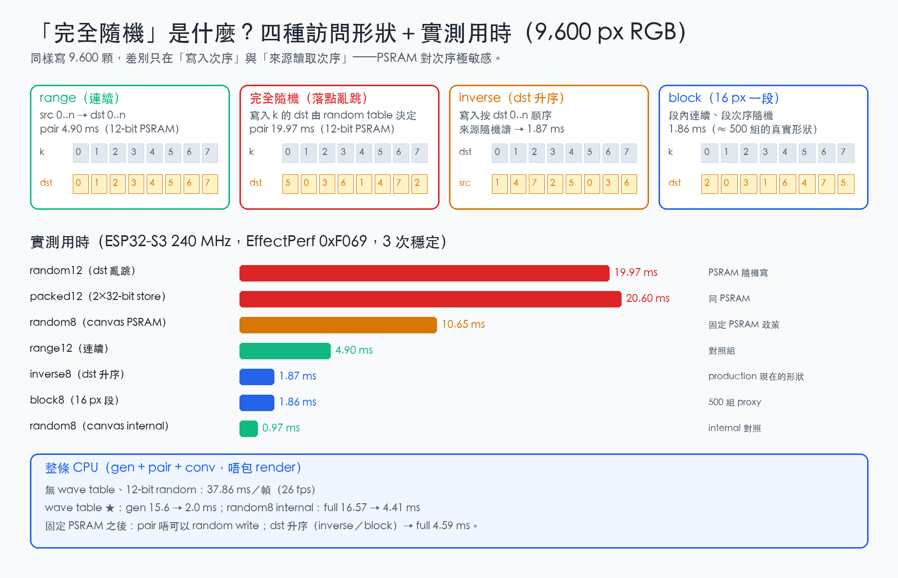

# 排版配對：自描述 layout → destination 順序寫入表

> **2026-11-22。** 這一頁解「500 個組合的排版，在 16×600（9,600 px）、以至 37 slave／15,808 px
> 的真實 show 上，配對到底怎樣做」。
>
> 相關：[psram-service-pipeline.md](psram-service-pipeline.md)（PSRAM 單一服務路徑與 8/12-bit 成本）、
> [show-pipeline.md](show-pipeline.md)（effect → pair → render 三任務）、
> [../03_notes/ncm-format.md](../03_notes/ncm-format.md)（自描述容器的既有做法）、status §7.172。

---

## 1. 起點：排版檔案本身是自描述的

舊項目（`mp_Net-Core/slave`）的 `pixel/map/*.json` 定義了排版：

```json
{
  "name": "gundam",
  "groups": [
    { "id": 1, "name": "body", "sel": [
        {"type": "pwm",    "sel": "10:15"},
        {"type": "ws2812", "sel": "40:200"},
        {"type": "ws2812", "sel": ":10"},
        {"type": "pwm",    "sel": "15:10:-1"} ]},
    { "id": 2, "name": "motors", "sel": [{"type": "uartMotor1", "sel": ":"}] }
  ]
}
```

- 一個 **group = 有序的段列表**（`sel[]`）；段依書寫次序拼接 = 像素次序。
- 段可 **交叉型別、反序（`15:10:-1`）、隔顆（`::2`）、單顆（`7`）、重疊**。
- 展開結果 = 該 group 一條 **有序全域 pixel index 列表**。
- mode 的每一項 = `group × effect × write × range`；`range` 是對該列表再切一次。

即係：**「500 個組合」＝ 一個 map 裏面 500 個 group，全部在 16×600＝9,600 顆的 index 空間裏面揀。**
檔案自己講明幾多組、每組幾長、點揀，firmware 不應該用固定常數決定。

### 1.1 firmware 現在的失真（每一條都是靜默截斷）

| 失真 | 代碼位置 | 後果 |
|---|---|---|
| group 上限 16 | `nc_px_layer.h: NC_PX_GROUP_MAX` | 第 17 組消失 |
| 每組 `sel` 上限 8 | `NC_PX_GROUP_SEL_MAX` | 第 9 段消失 |
| 反序 `"15:10:-1"` | `nc_px_show.c: expand_slice()` step<0 → `return 0` | **整段靜默變空** |
| 隔顆 `"::2"` | 同上 step>1 拆單點、`cap=4` | 600 顆只取到 **4 顆** |
| 每 job 段數 4 | `NC_PX_JOB_RANGE_MAX`（`apply_range()` 再截） | 第 5 段起消失 |
| mode 條目 8 | `NC_PX_MODE_ENTRY_MAX` | 第 9 個條目消失 |
| 值流 256 | `nc_pipeline.h: NC_PIPE_VAL_MAX` | `pixel_n > 256` 被切，空間分佈錯 |
| index 16-bit | `nc_px_job_range_t.base/count`（uint16） | 65,535 顆上限、且假設連續 |

所以 500 組的真實排版**入唔到 production**；probe 的 9,600 px 也只是「一條連續鏈」。

---

## 2. 自描述的三個要求

1. **準確定址**：每一個輸出位置由檔案指出（per-pixel index），不靠 `base + count` 假設連續。
2. **不受位寬限制**：index 用 **32-bit**（舊項目遇到 65,535 是直接 raise，等於不能表達）。
3. **不受空間切割影響**：inventory 只講「型別／起點／長度」；37 個 slave（336／776／1,584 px）
   與 16×600 都係同一種描述，換硬件只換數字，不改 code。

**已存在的同類做法**：PXLD v3（`tools/PC/PXLDv3Splitter.py` + `tools/PC/show_test.pxld`）。

```text
header            : magic "PXLD" / major=3 / fps / total_slaves / total_frames / total_pixels
每幀 frame header : slave_table_size / pixel_data_size
每幀 slave entry  : {slave_id, channel_start, channel_count, pixel_count, data_offset, data_length}
pixel data        : 按 entry 的 data_offset／data_length 切
```

實檔 `tools/PC/show_test.pxld`：**37 slaves、15,808 px、12,444 幀、40 fps**，
每 slave 336 / 776 / 1,584 px，channel_count 976 / 2,328 / 4,752。
每個 slave 由自己的 entry 知道「我負責邊一段」，**唔需要 firmware 寫死切割方式**。

這正是排版配對要照抄的原則：**切法係資料，唔係常數。**

---

## 3. 裝置端：把排版編譯成 destination 順序寫入表

散落寫入（group 次序）在 PSRAM 是 10.647 ms（9,600 px，random8）；
destination 順序寫入是 **1.872 ms（inverse8）**——兩者寫入次數一樣，只是次序不同。
所以要保留「任意組合」的表達力，同時拿到順序寫入的速度：**在 plan 建立時編譯**。

### 3.1 編譯結果（plan 的熱路徑只有兩張表）

```c
// 一個效果（值流）；同一個 asset 只編一次 program
typedef struct {
    const nc_px_asset_t *asset;
    nc_px_prog_t         prog;
    uint32_t             nv;        // 值流長度（= pixel_n，data-driven）
    uint32_t             vals_off;  // 在值流池的位置
} nc_px_aprog_t;

// 一個 mode 條目
typedef struct {
    uint16_t aprog;                 // index into aprog[]
    uint8_t  write;                 // r/g/b/w/ww/rgb/rgbw/wwww
    uint32_t nled;
} nc_px_ljob_t;

// destination 升序的寫入表（continuous run）
typedef struct {
    uint32_t dst;        // 全域輸出位置 0..px-1（32-bit，無 65,535 上限）
    uint32_t src;        // 值流 index k（= 該組像素列表的第 k 顆）
    uint32_t count;      // 連續幾顆
    uint32_t job;        // index into job[]
} nc_px_lrun_t;          // 16 B
```

- `runs` 按 `dst` 升序；**pair 只順序掃 runs**，每個 run 連續寫 `count` 顆。
- 值流 `vals[job][k]`，`k` 用 `src`；值流不足時 `src`/`k` 取模（沿用舊語義）。
- 重疊寫（同一顆被多個 entry 寫不同通道）保持 **entry 次序**：同一個 `dst` 的多個 run
  按原 entry 次序排，先寫先落。
- **值流按 asset 去重**：`nc_px_job_vals()` 只依賴 asset（program／pixel_n／speed／step／
  spacing／offset／reverse），唔依賴 group；所以 500 個 group 共用 20 個效果時，
  只需 20 條值流（job 存 `asset` 索引）。9,600 px 每顆一個波時才是 1 條 28,800 值的流。

### 3.2 編譯算法：counting bucket，唔用 comparison sort

```text
expand(mode, map, inv):
  n = Σ 每個 entry 的 group 長度（套 range 後）
  pass 1：數每個 dst 有幾個 entry 寫 → count[dst]
  pass 2：prefix sum → 每個 dst 的 bucket 起點（cursor）
  pass 3：按 entry 次序逐顆 append (job, k) 入 bucket[dst]（穩定，保持寫入次序）
  pass 4：dst 0..px-1 掃一次，同一 job 且 dst／k 都連續 → 合併成 run
```

- 成本 **O(px + n)**，無 qsort；9,600 px／500 組在 S3 估 10–20 ms，**只在換場做一次**。
- run 數 ≈ **所有 group 的 `sel` 段數**（sort 後相鄰合併），唔係 px 數：
  500 組 × 1–3 段 ≈ 500–1,500 runs；快取友好的 3–12 KB 表。

### 3.3 熱路徑（pair）

```c
for (r = 0; r < nruns; r++) {
    const uint16_t *vals = frame->vals + job_off[run[r].job];
    uint16_t nv = job[run[r].job].nv;
    for (x = 0; x < run[r].count; x++) {
        uint8_t *o = canvas + ((run[r].dst + x) << 2);
        write_channel(o, vals[(run[r].src + x) % nv], job[run[r].job].write);
    }
}
```

- dst 嚴格遞增 → PSRAM 寫入順序、cache line 友善。
- `src` 可能跳（group 次序 ≠ 物理次序）→ 讀的是值流（小 buffer，internal）。
- 這正是 inverse8 的形狀：**實測 1.872 ms（9,600 px）**。

---

## 4. 成本模型（500 組、16×600 = 9,600 px）

| 情況 | run 數 | pair（估） | full（wave gen 2.0 + pair） | 50 fps 佔用 |
|---|---:|---:|---:|---:|
| 一條連續鏈（現時） | 1 | 1.87 ms（實測 inverse8） | 3.9 ms | 20% |
| 500 組、每組 1 段 | ~500 | ≈1.9 ms（proxy：600 段 1.864 ms） | ≈3.9 ms | 20% |
| 500 組、每組 2–3 段 | ~1,000–1,500 | ≈1.9–2.2 ms | ≈3.9–4.2 ms | 20–21% |
| 最壞（每顆一段） | 9,600 | ≈1.9–2.5 ms（多 9,600 次 run 迭代） | ≈3.9–4.5 ms | 20–23% |

關鍵：**排序後的 runs 令 worst case 同 best case 幾乎一樣**；完全隨機只係多 run 迭代，
唔再係 PSRAM random write。舊量測的 10.647 ms 是「照 group 次序直接散落寫」，不是同一個形狀。

> 註：上表 pair 用 8-bit canvas、PSRAM（固定政策）。12-bit canvas 仍然不建議
> （見 psram-service-pipeline.md §6.3）。估算的 run overhead 要在階段 2 的 host bench
> 用真 500 組排版量一次，才算正式數字。

## 5. 記憶體（9,600 px／500 組）—— 2026-11-22 修正後

**教訓**：第一版把 3 份 aprog（各 17 KB，含 16 段編譯 program）放 **internal BSS**
＝ **51.5 KB**；再加 pair 的 asset 表 8.4 KB、0xF06B 快照 2 KB ＝ **62 KB**。
用戶只有 ~100 KB internal，等於一個任務食咗一半以上。已全部搬去 PSRAM。

| 位置 | 項目 | 大小 |
|---|---|---:|
| **internal（靜態）** | pair 狀態（layout／指標／計數） | **220 B** |
| internal（靜態） | effect：frame 272 B ＋ 指標／計數 ~280 B | **552 B** |
| internal（heap） | wave table：每條值流 512 B（最多 4,096 值＝8 KB） | 0.5–8 KB |
| internal | 任務 stack（pair／effect 各 4 KB，本來就有） | 8 KB |
| **PSRAM** | canvas 8-bit（9,600 px） | 38.4 KB |
| PSRAM | layout：jobs（500 × 8 B）＋ runs（500–1,500 × 16 B）＋ aprog（532 B／效果） | 4–24 KB |
| PSRAM | 值流 pool ×2（按 asset 去重） | 0.3–115 KB |
| PSRAM | map pool（500 組）＋ mode pool（500 條目） | ~64 KB |
| PSRAM | asset 表 8.4 KB ＋ 0xF06B 快照 2 KB | 10.4 KB |
| PSRAM（**暫存**） | 編譯：index pool／tmp／counts／cursor／entries／runs | ~355 KB，換場後 free |

- **每幀固定要讀的 internal**：runs 指標（4 B）＋ wave table（512 B）＋ frame 272 B。
- runs 目前在 PSRAM：500 組 = 8 KB／幀（≈0.3 ms）；1,500 組 24 KB（≈1 ms）。
  想省呢 0.3–1 ms，可以把 runs 改 8 B（dst/src 用 uint16）再放 internal（4–12 KB）。
- 編譯暫存是**一次性**（每次換場），唔係每幀。

## 6. 一次性 vs 每幀

| 成本 | 幾時付 | 次數 | 9,600 px 實測／估算 |
|---|---|---|---:|
| 讀 `/data/pixel` JSON＋解析（map／mode／effects） | 開機／reload／換場 | 一次 | host 0.87 ms（500 組）；板上估 5–15 ms |
| group → index → dst bucket → run 合併 | 換場 | 一次 | host 0.66–0.87 ms；板上估 10–20 ms |
| program 編譯 ＋ wave table 建立 | 換場 | 一次 | 512 B／效果；compile 每效果 ~µs 級 |
| 值流 pool 配置（PSRAM） | 換場 | 一次 | 0.3–115 KB |
| **gen 值流（每幀）** | 每幀 | N | 64 值 → ~7 µs；28,800 值 → 2.0 ms |
| **pair 掃 runs 寫 canvas（每幀）** | 每幀 | N | 1.86–1.9 ms（9,600 px，PSRAM） |
| white mix（每幀） | 每幀 | N | 38.4 KB × 4 通道，~0.1–0.4 ms |
| canvas → 環 memcpy（每幀） | 每幀 | N | 38.4 KB |
| runs 讀取（每幀） | 每幀 | N | 8–24 KB → 0.3–1 ms |
| render encode ＋ tx | 每幀 | N | 16 lane × 600 px = 18 ms（物理） |

**結論**：排版／解析／編譯全部是**換場一次**；每幀只剩下「值流、runs 寫入、white mix、
commit、render」。如果連換場的那 10–20 ms 都想省，就做 PC 預編譯 `.pxlt`（階段 5）。

## 7. 真檔基準

| 基準 | 數字 | 用途 |
|---|---|---|
| **16 × 600** | **9,600 px** | 設計／測試上限（所有量測以此為準） |
| 真檔 `tools/PC/show_test.pxld` | 37 slaves、15,808 px、40 fps | 真 show 的下限驗證（含不規則切割） |
| 37 slave 切割 | 336 / 776 / 1,584 px | 「空間切割不影響描述」的測試案例 |

## 8. 遷移階段（2026-11-22 已落地 1–4）

| 階段 | 內容 | 狀態 | 驗收 |
|---|---|---|---|
| 1 | map／mode 結構 data-driven：group／sel／mode 條目由檔案大小決定；反序／隔顆／重疊；32-bit index | ✅ | `pxLayer_test`：count／pool 解析、反序、隔顆、重疊、跨型別 |
| 2 | 編譯器：group → index → dst bucket → runs（O(n)） | ✅ | 新 `pxLayout_test`：反序、隔顆、重疊、500 組 × 9,600 px |
| 3 | plan／pair 改讀 runs；舊 `nc_px_pair_apply` 保留 A/B | ✅ | `pxLayout_test` 新舊 path 逐 byte 對拍；`pxShow_test` 全綠 |
| 4 | job 數／值流長度 data-driven（取消 8 job、256 值、65,535 index） | ✅ | 500 條目 mode、值流按 asset 去重、`nv = pixel_n` 無上限 |
| 5 | （可選）PC 預編譯成自描述 `.pxlt`，ESP 開機直接載入 | ⏸ | 未做；現時 ESP 開機由 JSON 編譯 |
| 6 | 真機 probe：9,600／15,808 兩個尺寸、500 組任意組合 | ⏸ | 未做（要上板） |

### 8.1 實作位置

| 檔案 | 內容 |
|---|---|
| `sw/pixel/include/nc_px_layer.h` | `nc_px_group_t`／`nc_px_map_t` 改 pointer＋`nc_px_map_pool_t`；mode 條目改 pointer；`nc_px_hw_inv_t` 32-bit |
| `sw/pixel/asset/nc_px_layer.c` | 兩步解析：`nc_px_map_count()`／`nc_px_map_parse(pool)`、`nc_px_mode_count()`／`nc_px_mode_parse(pool)` |
| `sw/pixel/include/nc_px_layout.h` | `nc_px_aprog_t`／`nc_px_ljob_t`／`nc_px_lrun_t`／`nc_px_layout_t` |
| `sw/pixel/asset/nc_px_layout.c` | 編譯（counting bucket＋run 合併）／`apply`／`apply12`／`aprog_vals` |
| `tasks/pixel_effect_task/nc_effect_task.c` | 每條值流一個 pool（×2 雙緩衝）、ack 防撕裂、wave table per aprog |
| `tasks/pixel_effect_task/nc_pair_task.c` | mode switch 建 layout、發佈 aprog、逐幀 `nc_px_layout_apply` |
| `tools/hosttest/pxLayout_test/` | 新 host 測試（500 組、反序、隔顆、重疊、新舊對拍） |

### 8.2 實測（host x86）

- 500 個 group、16×600 = 9,600 px、隨機段次序：**build 0.66–0.67 ms、apply 0.03 ms**
  （apply 是 9,600 次順序寫；真機 PSRAM 版的對照數字是 inverse8 1.872 ms）。
- 反序 slice：舊 path 會整段丟棄 → 新 path 16 條 run（dst 16..31 ← src 15..0）。
- 隔顆 `"::2"`：舊 path 只取 4 顆 → 新 path 16 顆。
- 重疊寫：兩個 job 寫同一批燈的 R／G，互不清走。

### 8.3 真機實測（2026-11-22，Zero，OTA）

`0xF077 LAYOUTBENCH`（EffectPerf）、9,600 px、canvas／runs 全部 PSRAM：

| groups | runs | build（換場一次） | apply8（每幀） | apply12（每幀） |
|---:|---:|---:|---:|---:|
| 100 | 100 | 32.4 ms | 3.17 ms | 5.39 ms |
| **500** | **500–1,000** | **39–40 ms** | **3.7–4.1 ms** | **5.6–5.9 ms** |
| 1,000 | 2,000 | 50.7 ms | 4.77 ms | 6.12 ms |

- build 加 name hash 前：500 組 65 ms、1,000 組 **162 ms**（O(entries×groups) 的 strcmp）。
- apply 的瓶頸是 PSRAM 寫入頻寬（38.4 KB／幀，10–14 MB/s），唔係 modulo；
  內圈已改計數器回繞（避免 `% nv`）。
- production 64 px：effect 6 µs、pair 42 µs、render 49.9 fps，`h_int 180 KB`。

詳見 status §7.175。

### 8.4 16×600 production（9,600 px，2026-11-22）

`ESP32-S3-Zero-Show9600`（501 組 map、三條 mode；render 用 mock 令 pair 可以 50 fps）：

| mode | effect | pair | apply | commit | render |
|---|---:|---:|---:|---:|---:|
| full256 | 42 µs | 9.69 ms | 5.17 ms | 4.51 ms | 50.0 fps |
| g500（500 組） | 39 µs | 9.65 ms | 5.17 ms | 4.49 ms | 50.0 fps |
| full9600（28,800 值） | 365 µs | 10.25 ms | 5.88 ms | 4.37 ms | 50.0 fps |

- `h_int` 199 KB、`h_ps` 1.5 MB（環 115 KB ＋ canvas 38.4 KB 在 PSRAM）。
- 9,600 px 的 CPU 仍有 50 fps 餘量；**render** 才是牆：I80 packed 波形 ≈10 MB 起唔到，
  真出燈要改 packing ＋ 16 lane（單 lane 288 ms/幀）。
- 詳見 status §7.176。

### 8.5 未做

1. **真機 probe**（9,600／15,808 px）——要上板；sandbox 擋 `/dev`，需要批准。
2. PC 預編譯 `.pxlt`（階段 5）：可以省 boot 時 JSON 解析＋編譯，但要重傳整包。
3. 16 lane render（`next-steps §13`）：9,600 px 要 16 lane 才 50 fps。
4. 值流極限：`pixel_n = 9,600`（rgb = 28,800 值 = 57.6 KB）在 PSRAM 雙緩衝；
   真機記憶體要再確認。

---

## 9. 圖解：之前的測試、緩衝政策、「完全隨機」

圖由 `tools/pixel_pairing_figs.py` 產生（Pillow；改數字後重跑即可）。

### 9.1 固定緩衝政策



- **HOT（internal）**：layout 熱路徑（runs／jobs／aprog）、wave table、asset 表、I80 DMA 緩衝。
- **BULK（PSRAM）**：8-bit canvas（9,600 px = 38.4 KB）、值流 pool ×2、I80 packed 波形、
  probe 的 12-bit canvas、map／mode pool、layout 編譯暫存。
- 冇 runtime「睇 free heap 揀位」；allocation 失敗就 log／task 失敗。
  冇 PSRAM 的板（Matrix）只有值流 pool 退 internal——那是板子能力，不是按 buffer 大細的智能選擇。

### 9.2 之前的測試是怎樣做的



- 專用 **EffectPerf 映像**（只編 `effect_bench`，冇 render／network／ncm），
  `tools/pipe_bench.py` 經 CDC 或 WebMaster REST 發 `0xF069`。
- handler 先配置：`vals` 57.6 KB、8-bit canvas 38.4 KB、12-bit canvas 76.8 KB、tables，
  再用 `esp_timer` 分段計時（gen／pair／conv），回 JSON。
- 同一份 C 實作、同一顆 S3 240 MHz；**唔初始化 I80、唔送燈**，所以只量 CPU／記憶體。
- 位置用 `esp_ptr_internal()`／`esp_ptr_external_ram()` 證實，唔靠推測。

### 9.3 「完全隨機」到底是什麼



設定：`px=9600`、`nv=28800`（rgb 3 值／顆）、`table_rnd[k] = (k × 7919) % 9600`（近似隨機 permutation）。

| 寫法 | 意思 | 時間（9,600 px RGB） |
|---|---|---:|
| range | src 0..n → dst 0..n | 4.90 ms（12-bit PSRAM） |
| **random12** | 第 k 個值的落點亂跳（= 完全隨機） | **19.97 ms** |
| packed12 | 每顆 2×32-bit store，仍然亂跳 | 20.60 ms（證明 store 次數唔係主因） |
| random8（c8 PSRAM） | 8-bit canvas，落點亂跳 | 10.65 ms |
| inverse8 | dst 升序、來源隨機讀 | **1.87 ms** |
| block8 | 16 px 一段、段次序隨機（≈500 組） | 1.86 ms |
| random8（c8 internal） | 對照：internal 隨機都快 | 0.97 ms |

- 12-bit 慢 20× 的原因：76.8 KB 放唔落 internal（`vals` 57.6 + `c8` 38.4 + `tables` 38.4 已佔用）
  → 落 PSRAM → **random RMW**；不是「四個通道分四次 store」。
- 整條 CPU（gen + pair + conv）：無 wave table 的 12-bit random 是 **37.86 ms／幀（26 fps）**；
  有 wave table ＋ 8-bit internal random 是 **4.41 ms**；
  固定 PSRAM 之後用 dst 升序（inverse／block）是 **4.59 ms**。
- 所以「完全隨機」不是不可行，是**唔可以用 group 次序直接散落寫**；
  編譯成 dst 升序的 runs 之後，worst case 同 best case 幾乎一樣。
