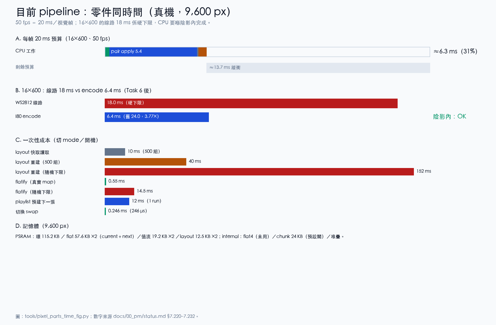

# FPS 穩定度：量測與判讀

> 目標：唔止「平均 50 fps」，而係**每一幀都準**（絕對穩定）。
> 工具：`tools/fps_trace.py`（0xF081）；圖：`docs/assets/pixel-pairing/parts-time.png`。

---

## 1. 為什麼平均 fps 會騙人

`0xF071` 的 `fps_x10` 係「每秒平均」：一秒內有 48 幀 + 2 幀特別慢，平均仍然似 50。
真正影響觀感的是**逐幀間隔**（jitter）同**長 gap**。所以 firmware 另外記：

| 指標 | 意思 |
|---|---|
| `target_us` | 設定節拍（system.json `frame_interval_ms` × 1000） |
| `n` | 已記錄幾幀 |
| `avg_us` / `sd_us` | 平均間隔／標準差（sd 細 = 穩） |
| `min_us` / `max_us` | 最短／最長間隔（max 最有用） |
| `bad` | `|dt − target| > 20%` 的次數 |
| `hist[64]` | 1 ms 一格（0–62 ms，63 = ≥63 ms）的分佈 |
| `starved` | render 想取新格但環冇（生產者唔夠快） |
| `late` | 這一輪做超過一個 period |
| `frames` | 累計送出的幀 |
| `slack_us` | **時間銀行**目前存了幾久（上限＝Kconfig `NETCORE_PIXEL_SLACK_MS`） |
| `catchup` | 用存下的時間頂住尖峰的次數 |
| `overrun` | 尖峰超過存款、被迫重排的次數 |

---

## 2. 用法

```bash
# 追 10 秒（每 0.5 秒取樣一次），開始前清零
python3 tools/fps_trace.py --port /dev/cu.usbmodemXXXX --seconds 10 --reset

# 出 CSV ＋ PNG（histogram＋fps 時間線）
python3 tools/fps_trace.py --port /dev/cu.usbmodemXXXX --seconds 30 \
    --reset --csv /tmp/fps.csv --plot /tmp/fps.png
```

終端摘要例：

```
target      20000 µs（50.00 fps）
frames      500
avg         20003 µs（49.99 fps）
sd          41 µs（0.21% of target）
min / max   19940 / 20890 µs（max deviation 890 µs）
bad         2（|dt-target| > 20%）
hist top    20 ms×498，21 ms×2
starved     0（環冇新格）；late 0；frames 500
verdict     STABLE
```

判讀：

| verdict | 條件（工具用） | 意思 |
|---|---|---|
| `STABLE` | sd ≤ 1% target，max deviation ≤ 25% | 可以接受 |
| `BORDERLINE` | sd ≤ 2% | 偶爾有尖峰，要查 hist |
| `UNSTABLE` | sd > 2% 或 max deviation > 25% | 要修 |

---

## 2.5 時間銀行（deadline 時鐘）

Render 唔再用固定週期 timer，而係 **deadline ＋ slack**（`nc_fps_clock.c`）：

**週期 timer 仍然係主人**：節拍完全由 `system.json` 的 `frame_interval_ms` 控制
（`esp_timer_start_periodic`），緩衝**唔會改週期、唔會追趕**。

時間緩衝（slack）只做兩件事：
1. **吸收判定**：早完成 → 存入（上限 `NETCORE_PIXEL_SLACK_MS`，預設 50 ms）；
   遲到 → 由緩衝吸收；吸收得到 → `catchup +1`（視為可接受波幅）；
   吸收唔到 → `overrun +1`（尖峰超出緩衝，要查）。
2. **穩定度指標**：`slack_us／catchup／overrun` 直接顯示「緩衝夠唔夠」。

**銀行一開始就係滿的**（避免開機先追趕、影響同步）；之後早完成才補、遲到才花。
好處：平均 fps 準（唔漂移）；臨時尖峰可以吸收；尖峰過後自動補回存款。
Kconfig：`NETCORE_PIXEL_SLACK_MS`（0 = 關閉，等於固定節拍；範圍 0–2000）。
Host 測試：`tools/hosttest/fpsclock_test`（準時／存錢／花錢／爆額／wait 邊界）。

## 2.6 漂移重複量測（決定兩塊 ESP 幾久同步一次）

```bash
python3 tools/fps_drift.py --port /dev/cu.usbmodemXXXX --windows 6 --window 30
```

每輪清零 → 等 30 s → 讀 `avg_us`；`ppm = (avg − target) / target × 1e6`。

- `mean／sd／worst |ppm|`：ESP 內部節拍相對名義值的偏差。
- 兩塊 ESP 的**相對漂移**保守用 `2 × worst`（或 `sd`）。
- 工具直接換算 tolerance 1／5／20 ms 的建議 resync 間隔：
  `resync 秒數 = tolerance / (相對漂移 × 1e-6)`。

例：worst 20 ppm、相對 40 ppm → 1 ms 偏差要 25 s 同步一次；20 ms（一幀）要 500 s。

### overrun 的政策（重要）

- 緩衝（`NETCORE_PIXEL_SLACK_MS`）只用嚟吸收**臨時**波幅；`overrun > 0` 代表
  尖峰已經大過緩衝。
- **唔應該靠不斷加大 cap 解決**：cap 越大，代表容忍越大的延迟，反而更唔穩定。
- 如果長期 overrun：應該 **改效果（減少每幀工作）或降低 FPS**，而唔係加緩衝。
- 加大 cap 只可以做「已知一次性尖峰」（例如模式切換）的臨時保護。

## 2.7 小時級長跑（便宜、無人值守）

```bash
# 4 小時，每 60 秒取樣；板重啟會記 gap 並自動重連
python3 tools/fps_longrun.py --port auto --hours 4 --interval 60 \
    --csv artifacts/fps_longrun.csv
```

- 自動等板、自動重連；CSV 每行一個樣本。
- 完結印：ppm 平均／標準差／最壞、bad／overrun 總數、gap 次數、
  建議的兩塊 ESP 強制同步間隔。
- 夜間一鍵：`bash tools/fps_night.sh`（等板 → OTA 安全映像 → 4 小時長跑）。

## 3. 不穩時查什麼（按 histogram 形狀）

| 形狀 | 可能原因 | 查 |
|---|---|---|
| 全部集中 target，1–2 格有尖峰 | 偶發 task／USB ISR／flash 寫入 | `late`、`starved`、`drop` |
| 分佈向左（< target） | timer 太密／重複提交 | `frames` vs `n` |
| 分佈向右（> target） | 生產者慢（effect/pair）、環空 | `starved`、`0xF071` 的 `pair_n`／`eff_n` |
| 一段時間整體偏移 | 溫度／頻率／電源 | 長追蹤 30–60 s，睇時間線 |

**絕對穩定**的下一步（未有板，未做）：
- 如果 `starved` 高：render 可以「hold 最後一格」照送（保持線路節拍），
  但會在環恢復時多送舊幀；要同「用戶寫什麼就顯示什麼」原則對齊。
- 如果 `late` 高：render 一輪做太多（多 lane 編碼），要分 lane／分核。
- 如果尖峰跟 USB／log 有關：量測時關 log 或提高 render 優先級。

---

## 4. 零件時間（同一頁睇）



- 每幀 20 ms：CPU 約 6.3 ms（effect 0.3 ＋ apply 5.4 ＋ white 0.1 ＋ commit 0.5）。
- 16×600：線路 18 ms（硬下限）> encode 6.4 ms，所以 CPU 有陰影。
- 一次性：cache 10 ms／build 40–152 ms／flatify 0.55–14.5 ms／預建 12 ms／swap 246 µs。

---

## 5. 現況

- Firmware 0xF081／0xF082 已加入，Zero-Show 建置成功；host tests 全綠。
- **板嘅 USB 未返**（2026-11-25 01:24 之後），所以工具**未上板驗證**。
- 恢復步驟見 `status.md` §7.233：斷電重插 → 仍無 port 就 BOOT＋插電入 download mode，
  用 `artifacts/ESP32-S3-Zero.bin` 重燒。
