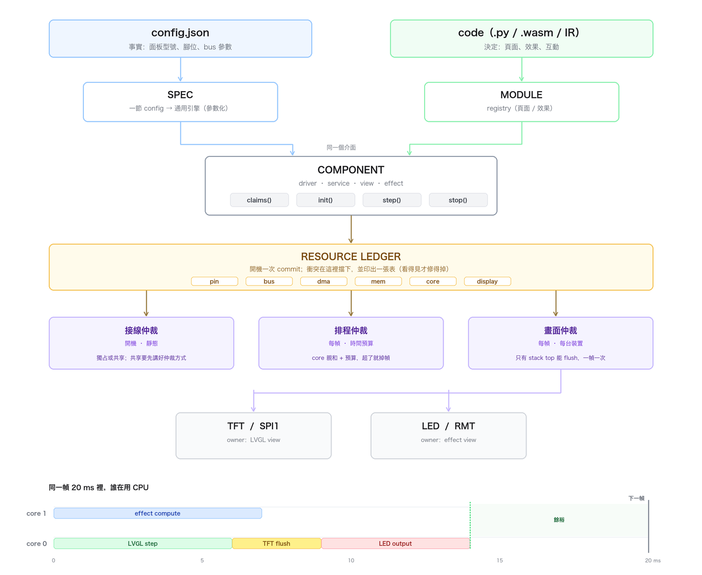

# 擴充架構：兩個插槽、一個帳本、三個仲裁

> **用途**：回答「TFT 靠一份 config 就能生出驅動、LVGL 靠寫程式就能改 UI —— 這兩種開發方式要怎麼並存？需不需要一套執行框架防止它們打架？」
> **對象**：要把 mp 版的 `gpio_claim` / `hw=("lcd",)` / `nc_plan` 收斂成 C 版骨架的人。
> **狀態**：設計提案。圖已完成；程式碼未動。
> **相關**：[buffer-manager.md](buffer-manager.md)（記憶體的 declare→commit）· [effect-language.md](effect-language.md)（效果插槽）· [architecture-flow.md](architecture-flow.md)（frame pipeline）



---

## 0. 一句話

**TFT 與 LVGL 不是兩種方法，是同一個 Component 的兩個入口：config 給「事實」，code 給「決定」。**

它們不會打架，因為它們搶的東西不同：**driver 搶接線（pin / bus），view 搶畫面（display）**。會打架的是第三件事 —— **時間**。所以要防的不是「兩種寫法衝突」，而是「兩個 Component 同時想要同一段 CPU 與同一台顯示器」。

---

## 1. 先把兩個例子拆開

### 1.1 TFT 為什麼吃一份 config 就夠

`config.json` 的 `TFT` 段只有十來個欄位：

```json
"TFT": {"driver":"ST7789", "width":240, "height":320, "rotation":0,
        "color_order":"RGB", "invert":0, "spi_id":1,
        "pixel_format":"RGB565_BE", "variant":0,
        "pins":{"dc":"tft_dc","cs":"tft_cs","rst":"tft_rst","bl":"tft_bl"}}
```

它能這麼短，是因為 **行為完全沒變**：初始化序列、開窗、寫像素、旋轉矩陣 —— 對 ST7789 / ST7735 / GC9A01 都是同一套流程，只是參數不同。所以程式碼寫一次（`lib/hw/TFT.py`），config 只挑型號與腳位。

這叫 **SPEC + ENGINE**：config 不是程式，是「同一個引擎的型號單」。

**判準**：**變的是「值」，不變的是「流程」→ config。**

### 1.2 LVGL 為什麼必須是 code

UI 變的是**分支**：按了會怎樣、有沒有登入、這頁要不要顯示電池、動畫中斷時去哪裡。這些不是參數，是控制流。硬要 config 化，你就會發明一個很爛的程式語言（低代碼平台的通病）。

`ui/lvgl/registry.py` 已經給出了正確答案 —— **程式碼 + 一個很小的宣告頭**：

```python
@register(id="home", title="首頁", icon="home", order=0)
def build(ui): ...
```

`@register` 只宣告「有這一頁、叫什麼、排第幾」，剩下的全是普通程式。**宣告的部分極小，行為的部分不受限** —— 這就是 1.1 的鏡像。

**判準**：**變的是「流程」→ code。**

### 1.3 一張表決定放哪

| 問題 | 放 config | 放 code |
|---|---|---|
| 這個面板是 240×320 還是 320×480？ | ✅ | |
| 按鈕按下去要跳到哪一頁？ | | ✅ |
| TFT 用 SPI1 還是 SPI2？ | ✅ | |
| 這一頁要不要顯示電量？ | | ✅ |
| 燈效的像素數 676？ | ✅ | |
| 這個燈效每一幀算什麼？ | | ✅ |
| WS2812 用哪隻腳？ | ✅ | |
| 矩陣第 (x,y) 像素對應燈鏈第幾顆？ | ✅（mapping 是資料） | |

一句話：**config 描述「有什麼、接在哪」，code 描述「做什麼、什麼時候做」。**

> 反例（兩邊都會痛）：把 LVGL 頁面做成 JSON → 低代碼地獄；把面板初始化序列寫死在 main → 換面板要重燒。

---

## 2. 現況盤點：同一個模式，你已經寫了五次

| 現有的東西 | 它其實是什麼 | 只管哪個軸 | 缺什麼 |
|---|---|---|---|
| `bus.gpio_claim()` / `gpio_validate()` | **資源帳本**（pin） | pin | 只認 driver 名，同 driver 兩個實例同腳位抓不到 |
| `Task.hw = ("lcd",)` + `_check_affinity` | **資源宣告**（core） | core | 一個硬編碼關鍵字，無法表達「共享」 |
| `nc_plan` declare → commit → shed | **資源帳本**（mem） | mem | 只管記憶體 |
| `bus.register_service()` | 服務定位 | — | 沒有生命週期（誰 init / 誰 stop） |
| `ui/lvgl/registry.py` | **模組插槽** | UI | 只有 UI 用 |
| `pixel/registry.json` | **模組插槽**（資料版） | pixel | 只有 pixel 用 |

**這不是六個機制，是同一個機制的六個影子**：宣告 → 檢查 → 拿。`nc_plan` 只是把「記憶體」那一軸做完整了，其他五軸都停在半路。

所以答案是：**不要新建框架，把這六個影子收斂成一個。**

> **進度（2026-11-02）**：C 版已經收了前四軸 —— 任務管理器（`nc_task_t`）一份宣告同時管
> 記憶體（`mem[]`）、迴圈與核心（`loops[]`）、接線（`claims[]`）、
> 生命週期（`start/stop` + `attach/detach`），並在開機印一張帳本表。
> `claims[]` 目前只做「exclusive 衝突檢查」，還沒有 `shared:cs` 那種共用模式；
> `display` owner stack 仍未做。
> **另外刻意沒搬過來**：mp 的 `hw=("lcd",)` → 強制 core0。IDF 上 flash 與 TinyUSB
> 都沒有「必須某一核」的硬性要求（細節見 [nc_task.h](../../firmware/components/sys/task/include/nc_task.h) 的註解），
> 所以 C 版的 core 完全由宣告決定，不強制改寫。見 [writing-a-task.md](writing-a-task.md)。

---

## 3. 抽象：Component 的四個面

不管是 driver、service、page、effect，都化成同一個東西：

```python
class Component:
    name  = "tft0"
    kind  = "driver"        # driver | service | view | effect

    def claims(self):       # ① 接線：我要什麼資源
        return [("bus", "spi1", "shared:cs"),
                ("pin", "tft_dc", "exclusive"),
                ("pin", "tft_bl", "exclusive"),
                ("display", "tft", "exclusive")]

    def init(self, ctx): ...   # ② 生命週期：一次
    def start(self): ...
    def step(self, now_us): ...  # ③ 排程：每幀或每 tick（可以不實作）
    def stop(self): ...          # ④ 生命週期：可重入
```

四個面剛好對應四個問題：

| 面 | 問題 | 誰回答 |
|---|---|---|
| **接線** `claims()` | 我用哪些 pin / bus / dma / 記憶體 / 顯示器 | 帳本（開機一次） |
| **行為** `init/step` | 我做什麼 | 作者（config 或 code） |
| **排程** `step(now)` | 我什麼時候跑、跑多久 | 仲裁者（每幀） |
| **生命週期** `start/stop` | 我能不能停、停了會不會漏 | 帳本 + 仲裁者 |

**關鍵**：`kind` 只有四種，`claims()` 只有一種寫法。這兩件事加起來，就讓「config 生成的 driver」和「手寫的 LVGL 頁面」在系統眼裡**完全一樣** —— 它們都只是「宣告了資源、有生命週期、可能每幀跑一次」的東西。

---

## 4. 三個仲裁者

衝突只會發生在三個地方。每個地方一個仲裁者，各自有明確的規則與輸出。

### 4.1 接線仲裁（開機一次，靜態）

**規則**

| 模式 | 意思 | 例子 |
|---|---|---|
| `exclusive` | 只有你能用 | TFT 的 dc / cs / rst / bl |
| `shared:cs` | 共用匯流排，用 CS 分時 | TFT + SD 共用 SPI1 |
| `shared:lock` | 共用，要拿鎖 | I2C 多裝置 |
| `shared:slot` | 共用，按時槽 | RMT 通道 |

**輸出**：一張表，開機印一次。

```
[ledger] pin
   4  tft_dc        tft0        exclusive
  15  tft_bl        tft0        exclusive
  16  ws2812_data   pixel0      exclusive
[ledger] bus
 spi1 tft0          shared:cs   cs=tft_cs
 spi1 sd0           shared:cs   cs=sd_cs
[ledger] CONFLICT
 pin 16: tft0(bl) 與 pixel0(data) 都想獨占 → 拒絕啟動 pixel0
```

衝突時的行為要分級（跟 `nc_plan` 的撇除同一個思路）：
- **L0 核心**（顯示、儲存）→ 衝突就**拒絕開機**並印明細
- **L1 條件**（pixel、audio）→ 衝突就**降級**（關掉該功能，其餘照跑）
- **L2 可選**（lab、web）→ 衝突就**跳過**

現有的 `gpio_validate()` 已經是這個東西的 pin 版，只是沒有分級、沒有其他軸。

### 4.2 排程仲裁（每幀）

現在的狀況：

| 事實 | 出處 |
|---|---|
| `LvglTask` 讀 `System.frame_interval_ms` | `tasks/lvgl_task.py:48` |
| `RenderTask` 也讀 `System.frame_interval_ms` | `tasks/render.py:27` |
| `LvglTask` 被 `hw=("lcd",)` 釘在 core0 | `task_manager._check_affinity` |
| `RenderTask` 也在 core0 | `tasks/render.py` |

→ **兩個 20 ms 週期的東西，搶同一個核，而且共用同一個 fps 旋鈕。** 改一個會動到另一個，這是一個潛伏的衝突。

**改成 per-device**：

```json
"Display": {
  "tft": {"fps": 30, "budget_us": 6000},
  "led": {"fps": 50, "budget_us": 12000}
}
```

每個 device 有自己的節拍；每個 task 宣告 `(core, period, budget)`。總和超過核的 100% 就在**開機**印警告（靜態檢查），執行期超過預算就**掉幀 + 記數**（跟現有 `[GATE]` 的 show/skip 統計同一個精神）。

**規則**：**超預算是掉一幀，不是延後下一幀。** 這條你已經寫在 `architecture-flow.md`，只是還沒套到 UI 上。

### 4.3 畫面仲裁（每幀，每台裝置）

這裡是最容易想錯的地方。不要做「一個全域 compositor」，要做「**每台 display 一個 owner stack**」。

因為衝突只存在於**同一台裝置**：

```
display "tft"   stack: [lvgl]                 ← LVGL 獨占整塊
display "led"   stack: [effect:fire]          ← 燈效獨占整條鏈
```

兩者毫不相干，永遠不會衝突。**真正需要仲裁的是「兩個 view 同時想要 tft」**：

```
stack: [lvgl, osd:電量提示]      ← LVGL 畫底，OSD 疊上層
stack: [lvgl(上半), preview(下半)]  ← 分區
```

三種模式，由下往上疊：

| 模式 | 語義 | 誰負責合成 |
|---|---|---|
| `exclusive` | 只有 top 能畫 | 不用合成，直接 flush |
| `region` | 各佔一塊矩形 | display 依 rect 裁切 flush |
| `overlay` | 疊在別人的畫面上 | 需要一塊 back buffer |

**規則**：**只有 stack top 能呼叫 `flush()`；一幀一次。** 這樣就不會出現「LVGL 正在 flush，pixel preview 插隊把 SPI 搞爛」的經典車禍。

> 這也是為什麼 LVGL 不該直接拿 `lcd_bus` —— 它應該拿 `display`。現在它是直接拿 `bus.get_service("lcd")`（`ui/lvgl/board.py`），等於**繞過仲裁直接抓硬體**。這是唯一需要改架構的地方。

### 4.4 三個仲裁者的關係

| | 接線 | 排程 | 畫面 |
|---|---|---|---|
| 什麼時候 | 開機一次 | 每幀 | 每幀 |
| 爭什麼 | pin / bus / dma / mem / core | CPU 時間 | 顯示器 |
| 誰宣告 | `claims()` | `Task(period, budget)` | `acquire(display)` |
| 衝突時 | 拒絕 / 降級 | 掉幀 | 排隊（stack） |
| 輸出 | 一張表 | `[GATE]` 統計 | 一張 owner 表 |

---

## 5. 分層（圖的文字版）

| 層 | 內容 | 只能被誰呼叫 |
|---|---|---|
| **L5 作者層** | config.json、`@register` 頁面、`.wasm` 效果 | 人 |
| **L4 插槽層** | SPEC 引擎（driver 工廠）、MODULE registry（page / effect） | 框架 |
| **L3 元件層** | Component（claims / init / step / stop） | 框架 |
| **L2 仲裁層** | Ledger（開機）、Scheduler（每幀）、Display owner（每幀） | 框架 |
| **L1 驅動層** | TFT / touch / ws2812 / sd / i2c devices | L3 元件 |
| **L0 資源層** | Pin / SPI / I2C / RMT / DMA / heap class | L2 帳本 |

### 5.1 跟 `rx-architecture.md` 是同一個形狀

你在 RX 那條路上已經做對了一次，這裡只是換一層：

| rx-architecture | 這裡 |
|---|---|
| `nc4_bus_registry`：只存 **ID**，描述子放固定 pool | **Ledger**：只存 `(kind, id, owner, mode)`，不存物件 |
| `nc4_decode_t` 引擎**實例**，`core` 是參數 | **Component 實例**，`core` / `budget` 是 claims 的一部分 |
| 掛的是 **bus ID** 不是物件指標 | claims 寫的是 **字串 ID**（`"spi1"`、`"tft"`），不是指標 |
| 單引擎 `attach_all` vs 明確 attach 分區 | 單 view `exclusive` vs 多 view `region` / `overlay` |

**同一個模式：註冊表存 ID、引擎可以換核、接線用宣告不用指標。**
這不是巧合 —— 這正是 MCU 上「可重組」唯一撐得住的寫法。

**鐵律：L1 以下不准被 L4 直接呼叫。** LVGL 要畫東西，只能透過 `display`（L2），不能碰 SPI（L0）。這一條就擋掉了 80% 的「打架」。

---

## 6. 具體介面（草案）

### 6.1 帳本

```python
# lib/sys/ledger.py
class Ledger:
    def claim(self, kind, ident, owner, mode="exclusive", **attrs):
        """kind: pin | bus | dma | mem | core | display"""

    def commit(self, policy="strict"):
        """回 True/False；永遠印表。衝突按 owner 的 level 決定拒絕或降級。"""
```

開機順序（跟 `nc_plan` 一樣，窗口在 commit 關閉）：

```
boot → 讀 config → 建 spec
     → 每個 Component 的 claims() 進帳本
     → ledger.commit()      ← 唯一檢查點，印表
     → 通過的才 init
```

### 6.2 顯示

```python
class Display:
    def __init__(self, name, w, h, flush_cb): ...

    def acquire(self, view, mode="exclusive", rect=None):
        """回 handle 或 None（被拒）。""" 

    def flush(self, handle, rect, buf):
        """只有 stack top 的 handle 合法；否則 assert 並記數。"""
```

LVGL 的 flush callback 只要改成呼叫 `display.flush()`，其餘不動 —— **這是整個改造裡最便宜的一步**。

### 6.3 插槽 A：SPEC 引擎（TFT）

```python
# config 的一節 → 一個 Component
comp = make_component("TFT", cfg["TFT"])
# 內部：SPEC → 查 driver 表 → 建 TFT 物件 → 包成 Component
```

**驗收**：`config.json` 把 `ST7789` 改成 `GC9A01`、`240x320` 改成 `240x240`，**一行 code 都不用改**。

### 6.4 插槽 B：MODULE registry（LVGL / effect）

```python
@view(display="tft", id="home", order=0)
def build(ui): ...
```

`@view` 做的事只有三件：排進 registry、在 `acquire()` 後呼叫 `build`、在 `release()` 時拆掉。行為完全是你自己的。

**驗收**：新增一頁只要加一個檔案，`config.json` 不用動。

---

## 7. 你會遇到的六個真實衝突

| # | 衝突 | 現在的症狀 | 解法 |
|---|---|---|---|
| 1 | `System.frame_interval_ms` 同時餵 LVGL 與 RenderTask | 調 UI 幀率會改到燈效 | per-device fps（§4.2） |
| 2 | LCD 與 RenderTask 都在 core0 | 兩個 20 ms 週期互搶，偶發掉幀查不出 | 預算表 + 超預算統計 |
| 3 | 同一個 driver 兩個實例佔同一腳位 | `gpio_validate` 抓不到（它比 driver 名） | claim 帶 instance id |
| 4 | LVGL 直接拿 `lcd` 服務 | 未來任何第二個 view 都會撞 | 改拿 `display`（§4.3） |
| 5 | `pins` 用 label 二層間接 | label 打錯，開機十秒後才炸 | commit 時解析 label，缺就報錯 |
| 6 | soft-reboot 後 LVGL C 層沒清 | 第二次初始化行為怪異 | `stop()` 契約 + 帳本記「誰沒還」 |

第 3、5 兩條是**現在就存在**的 bug，不是未來風險。

---

## 8. 完整計劃

| 階段 | 內容 | 估 | 驗收 |
|---|---|---|---|
| **P0 名詞** | 定 Component / Claim / Arbiter / View / Display；掃現有 driver 列 claim 清單 | 0.5 天 | 一張「誰要什麼」的表，涵蓋 20 個 driver |
| **P1 帳本** | `ledger.py`；`gpio_claim` 併入；`hw=("lcd",)` 改成 claim；commit 印表 | 2 天 | 故意造 4 種衝突，全部在開機擋下且訊息指出「哪隻腳、哪兩個 owner」 |
| **P2 畫面** | `display.py`（owner stack + flush 守衛）；LVGL 改走 display | 3 天 | 兩個 view 交替 acquire 不撕裂；非 top 呼叫 flush 被 assert |
| **P3 排程** | per-device fps；`(core, period, budget)`；超預算掉幀統計 | 2 天 | 把 LVGL budget 調到 3 ms，超了只掉 UI 幀，render 不受影響 |
| **P4 遷移** | TFT → Component；LVGL → view；config 分段 | 3 天 | 換面板型號不改 code；新增一頁不改 config |
| **P5 效果** | wasm view 掛上 `display:"led"`（接 effect-language.md） | — | 效果與 UI 同時跑，互不影响 |

**合計約 10.5 天**，P0–P1 不需要板子（純 Python / 純邏輯，可以 host 跑）。

**順序的理由**：帳本先做，因為它會立刻抓到現有的 bug（#3、#5），這是投報率最高的一步；畫面前端最後，因為它需要帳本當地基。

---

## 9. 決策記錄

| 方案 | 為什麼不用 |
|---|---|
| 寫一個新的大框架 | 你已經有 TaskManager + bus + 三張半成品帳本；重寫等於把除錯過的東西再除錯一次 |
| 全域 compositor（一個畫面合成所有來源） | MCU 上沒有記憶體做全畫面合成；而且 LVGL 與 LED 根本不同裝置，不需要合成 |
| 把 LVGL 頁面 config 化 | 會變成低代碼平台；分支一多就爆 |
| 把面板參數寫進 code | 換面板要重燒，違背「分離式固件」 |
| 讓 LVGL 自己管 SPI | 就是現在的做法，等於繞過仲裁 |
| 「每個功能一個 task」 | task 不是免費的（stack + 切換）；同一裝置的 view 應該共用一個 tick |

---

## 10. 待決事項

| # | 問題 | 建議 |
|---|---|---|
| 1 | `overlay` 模式要不要做 | 第一版只做 `exclusive` + `region`，overlay 等真的有 OSD 需求 |
| 2 | 帳本用 Python dict 還是 C 結構 | C 版用 static array + 字串池；mp 版先用 dict |
| 3 | 衝突的降級順序要不要 config 可調 | 先寫死 L0/L1/L2 三級，之後再開放 |
| 4 | `region` 模式的 flush 要不要支援部分更新 | 要（LVGL 本來就有 dirty rect），但先做全螢幕 |
| 5 | 這套要不要回移植到 mp 版 | 先在新 C 版落地，驗證後再回去 |
